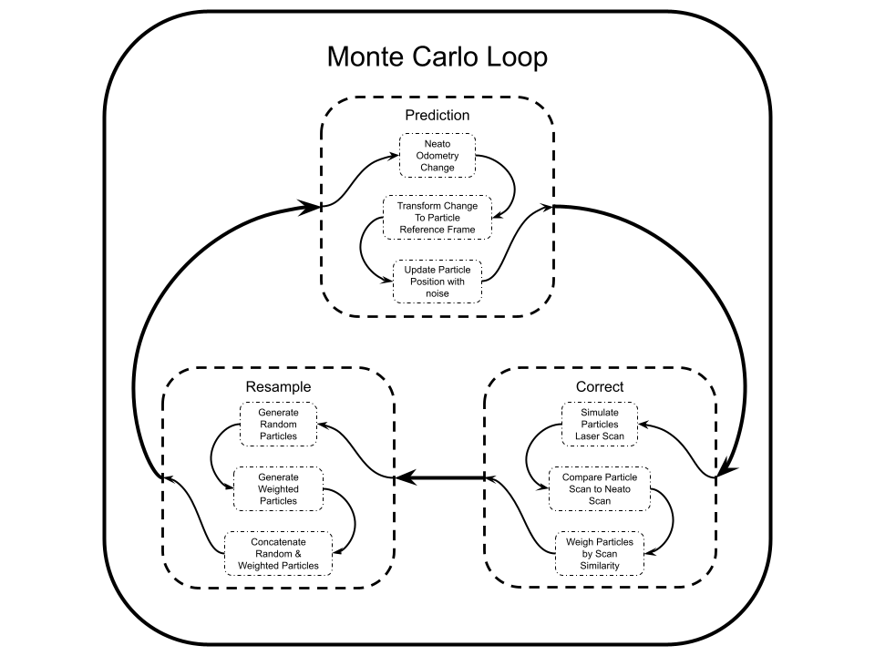
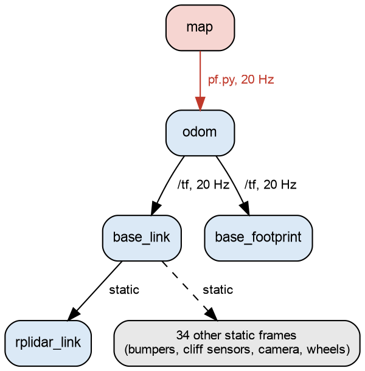
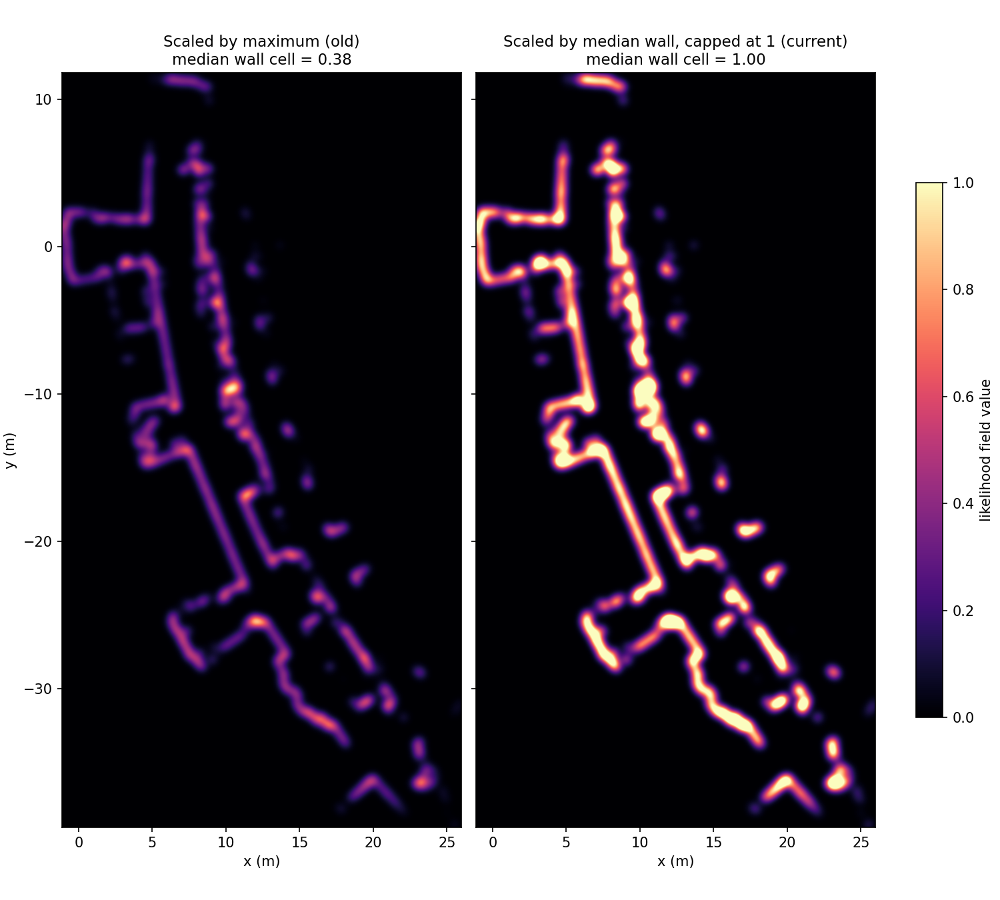
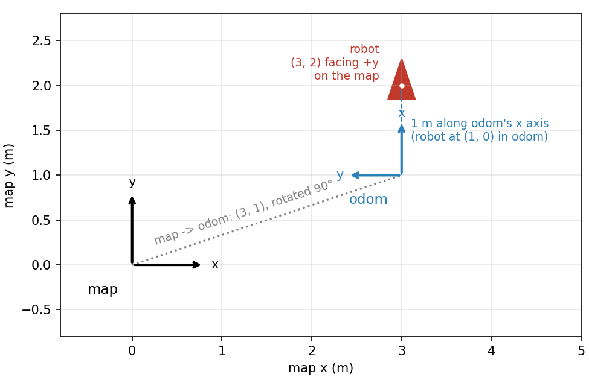
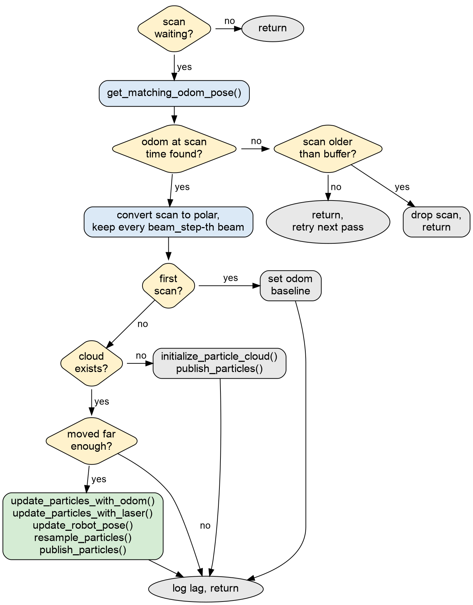
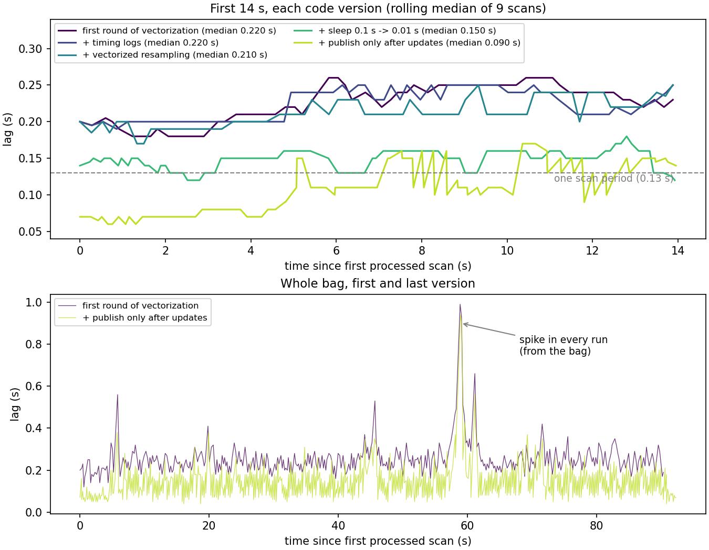
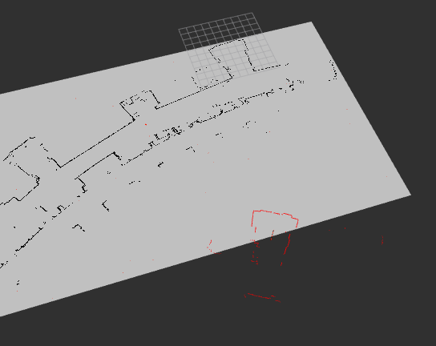
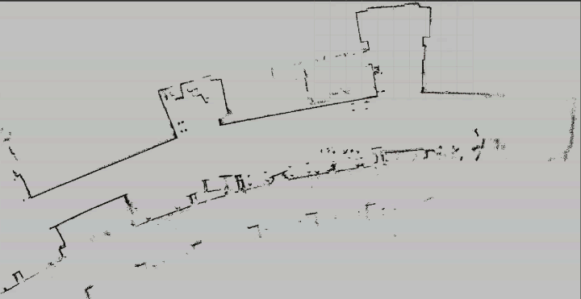
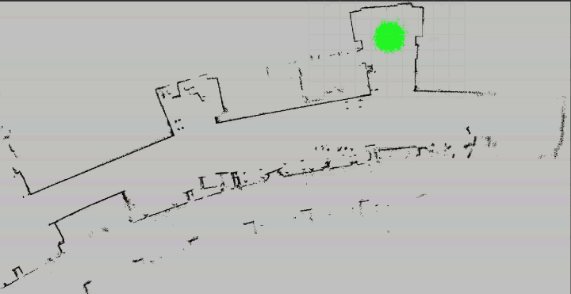
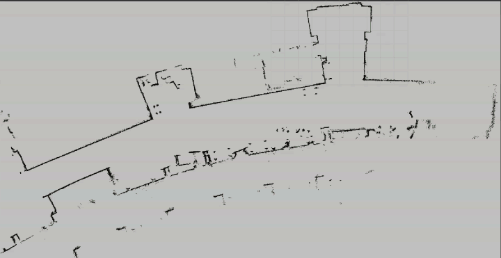

# Robot Localization via Monte Carlo Particle Filter

Author Names: Liam B., Enzo S.

For Olin ENGR3590 Computational Introduction to Robotics

This README is a comprehensive report covering both the conceptual math and the programmatic implementation of our Monte Carlo Localization (MCL) particle filter. Unless stated otherwise, the parameters in the tables below are the defaults declared in `pf.py`; a few figures and recordings were made with different values (mainly `n_particles`), though this is noted in line. All results come from the two Turtlebot 4 bags recorded on the first floor of the MAC, [`bags/macfirst_floor_take_1`](bags/macfirst_floor_take_1) and [`bags/macfirst_floor_take_2`](bags/macfirst_floor_take_2). For our purposes, the parameters were set with these environments in mind as opposed to the Neato Gauntlet World. 

A full index of every function and test, with one sentence on each and a link to where it is explained, is at the [end of this README](#index-of-functions-and-tests).

## 1. Project Overview

Given a robot in a known environment, we can poll the robot's sensors to determine what it "sees" around itself; however, there is no direct way from our known environment, or map, to extract the pose of the robot. Thus, we simulate thousands of particles and mimic the same sensing the robot experiences as the particles. Through this, we can determine which particles are likely to match our robot's pose, and without directly interacting with the robot, extract said robot's pose through this external algorithmic layer. This probabilistic guess and check is the fundamental approach behind Monte Carlo Localization particle filters. Picture the robot switched on somewhere on the first floor of the MAC (a building at Olin). It has a map of the building and two sensors: wheel odometry, which reports how far it has driven, and a 2D lidar, which reports how far away the nearest surface is in every direction. Independently, these sensors are unable to provide sufficient information for pose extraction - using odometry can only describe motion relative to the robot's starting location and the lidar can only describe the surrounding area with minimal ability to differentiate between seemingly similar environments. The goal of this project is to combine the two in a particle filter that keeps track of the robot's pose on a known occupancy grid map in ROS2.

The filter runs as a single node, `pf.py`, with five stages:

- [Particle cloud initialization & likelihood field precomputation](#map-and-init)
- [Motion model (odometry update)](#motion-model)
- [Sensor model (laser scan scoring)](#sensor-model)
- [Pose estimation & the map to odom transform](#pose-estimate)
- [Resampling](#resampling)

External but necessary to this process, we use 2D Gaussian convolution (`scipy.ndimage.gaussian_filter`) to build the likelihood field, rigid body frame transformations to move scans and particles between frames, log-likelihood summation with a scaling constant (`log_scale`) to score particles, vectorized NumPy array operations and broadcasting to update thousands of particles at once, and a circular mean to average headings.


We decided to work asynchronously, which led to us dividing the work for this project during meetings into discrete parts that we would complete before the next meeting. Respectively, we each wrote the code for:

- Enzo: likelihood field generation, motion prediction + correction
- Liam: particle initialization, particle resampling

We similarly worked on those respective areas within the README.

### 1.1 Monte Carlo Localization in Brief

Before getting into the code, we will describe the algorithm on its own. A particle is a single guess of the robot's pose, $[x\ (\mathrm{m}),\ y\ (\mathrm{m}),\ \theta\ (\mathrm{rad})]$, in the map frame, and its weight describes how well the most recent laser scan aligns with that guess. The filter keeps thousands of these guesses at once and repeats three steps every time the robot moves far enough:

```
for every update:
    predict:   move every particle by the odometry change, plus noise
    correct:   score every particle by how well the scan lines up with the map from its pose
    resample:  build a new cloud where high-weight particles get more copies
```

Keeping a cloud instead of a single estimate has the advantage of holding several possibilities, or pose guesses, at a time. If, for example, two hallways looked identical to the lidar, the filter could keep a group of particles at each hallway until more information arrives that could differentiate the two, unlike single-possibility algorithms such as a Kalman filter. With this, the cost of computation is far higher. This required a focus on computational efficiency in our work, as described later. 

Our implementation follows the particle filter and Monte Carlo Localization algorithms described in *Probabilistic Robotics* by Thrun, Burgard, and Fox (ch. 4 and ch. 8), visualized on a high level below in Figure 1.

<p align="center">  </p> <p align="center"><em>Figure 1: The MCL loop.</em></p>

### 1.2 Architecture

#### 1.2.1 Topics, TF Frames, and Threading

The filter is one ROS node, the <a id="pf-particlefilter"></a>`ParticleFilter` class, which <a id="pf-main"></a>`main()` creates and spins until shutdown. Its <a id="pf-init"></a>`__init__()` declares the parameters in Table 2, creates the subscribers, publisher, and timer in Table 1, creates the starter `OccupancyField` and `TFHelper` objects (Section 1.2.3), builds the likelihood field (Section 2.1.1), and starts the worker thread described below.

The node subscribes to the laser scan and to RViz's 2D Pose Estimate tool, publishes the particle cloud for visualization, and broadcasts a single transform, `map` to `odom`, which is how ROS learns where the filter thinks the robot is. Table 1 lists every topic and transform the node interacts with.

*Table 1: Particle filter node topics and TF transforms, with when each one is used and its role in the filter.*

| Topic / TF Frame | Direction | Message / Transform Type | When | Role |
| :--- | :--- | :--- | :--- | :--- |
| `/scan` | subscribe | `sensor_msgs/LaserScan` | every scan (~7.7 Hz in the bags) | Stores the newest scan in `scan_to_process` if the filter is free, and updates `last_scan_timestamp` |
| `/initialpose` | subscribe | `geometry_msgs/PoseWithCovarianceStamped` | on RViz 2D Pose Estimate click | Re-initializes the cloud as a Gaussian around the clicked pose |
| `/particle_cloud` | publish | `nav2_msgs/ParticleCloud` | after the cloud is created or updated | Displays every particle's pose and weight in RViz |
| `odom` -> `base_footprint` | TF lookup | `geometry_msgs/TransformStamped` | every `run_loop` tick | Retrieves the robot's odometry pose at the exact time the scan was taken |
| `base_footprint` -> `rplidar_link` | TF lookup | `geometry_msgs/TransformStamped` | per scan | Provides the lidar's (x, y) mounting offset on the robot |
| `map` -> `odom` | TF broadcast | `geometry_msgs/TransformStamped` | 20 Hz timer (+0.1 s postdated) | Corrects odometry drift by placing the odom frame on the map |

The particle cloud is published with `qos_profile_sensor_data`, which uses best effort reliability. Since the cloud is purely a visualization topic that gets replaced per update, the message being dropped, where best effort will not guarantee every message being sent or retransmitted if lost, is largely inconsequential. 

The filter itself does not run inside the scan callback. <a id="pf-scan_received"></a>`scan_received()` only stores the newest scan in `scan_to_process` once the previous scan has been handled, while <a id="pf-loop_wrapper"></a>`loop_wrapper()` calls `run_loop()` repeatedly on a separate daemon thread. This intentional decoupling prevents a slow filter update from blocking ROS callbacks, meaning scans that arrive while the filter is busy are discarded rather than accumulating in a queue and building delay in communication. Originally, `loop_wrapper` slept for 0.1 s between calls, so a scan that arrived immediately after a check could wait up to 0.1 s before `run_loop` processed it. Reducing the sleep to 0.01 s lowered the median lag over the first 14 s of the bag from approximately 0.21 s to 0.15 s (Section 3.2).

A 20 Hz timer, <a id="pf-pub_latest_transform"></a>`pub_latest_transform()`, re-broadcasts the latest `map` to `odom` transform with a hardcoded time stamped 0.1 s after the last scan's timestamp. Postdating, or adding time to the original timestamp, the transform prevents TF extrapolation errors in RViz between laser updates, and deriving the stamp from the scan rather than the wall clock keeps every node on bag time during playback so they are in unison.

One minor tweak for performance was modifying when the particle cloud is published. Initially, the cloud was published after every scan; however, publishing several thousand particles required 55 to 75 ms, which exceeded the cost of the filter update itself, and the cloud only changes when the filter updates. <a id="pf-publish_particles"></a>`publish_particles()` is now called only after the cloud is created or updated. <a id="test_every_particle_is_published"></a>`test_every_particle_is_published` replaces the publisher with a fake one and checks that a single message carries every particle with the right pose, weight, frame, and timestamp.

Because the bags were recorded on a Turtlebot 4 rather than a Neato, the sensor setup differs from the gauntlet simulation and previous project in three main ways:

1. The bag publishes both `odom` -> `base_link` and `odom` -> `base_footprint`. The filter tracks the robot through `base_footprint`, but the lidar is attached to `base_link` by a static transform, so `get_laser_offset` resolves the lidar's position through that chain, as shown in Figure 2. The resulting offset of about 4 mm is negligible next to the 0.03 m map cell, though this is good practice as the Neato has a non-negligible offset at this resolution.
2. `rplidar_link` is rotated by $\pi/2$ relative to the robot, while the Neato's laser faces backwards, a rotation of $\pi$. `convert_scan_to_polar_in_robot_frame` adds this yaw to every beam angle (Section 2.3.1). If it were omitted, every scan would be rotated relative to the robot, and the filter would favor particles with the wrong heading. `test_real_scan_from_the_gauntlet` checks this on a Neato scan (Section 2.3.4).
3. The rplidar returns 720 beams per scan, about twice the Neato's 361. Since scoring cost grows with the number of beams, this is the main reason for subsampling with `beam_step` (Section 2.3.1).

<p align="center">  </p> <p align="center"><em>Figure 2: TF tree during bag playback, map -> odom -> base_footprint, with the lidar attached through base_link.</em></p>

#### 1.2.2 Filter Parameters

Table 2 below lists every ROS2 parameter declared in `__init__()`, its function, and how its value was determined. Since they are declared as ROS parameters, each can be overridden at launch with `--ros-args -p name:=value` for ease of use.

*Table 2: Particle filter parameters, their defaults, tuning effects, and how each value was chosen.*

| Parameter                                   | Value                | Role & Tuning Effect                                                                                                                              | How It Was Chosen                                                                                                                                                                                                                                            |
| :------------------------------------------ | :------------------- | :------------------------------------------------------------------------------------------------------------------------------------------------ | :----------------------------------------------------------------------------------------------------------------------------------------------------------------------------------------------------------------------------------------------------------- |
| `n_particles`                               | 6000 particles       | More particles cover the map more densely, improving the reliability of global localization, at the cost of computation on every update           | Largest value that consistently reported a lag measurement of 0.13 seconds or under                                                                                                                                                                          |
| `d_thresh`, `a_thresh`                      | 0.05 m, $\pi/24$ rad | Distance or rotation required before the filter updates; smaller values produce more frequent updates and more frequent resampling                | The robot moves at relatively close to its maximum speed of 0.3 m/s, and with the scans arriving at roughly 7.7 Hz, we divided the original starting value by 4 to reach 0.05 m, which is close to 0.3 divided by 7. We applied this blindly to both values. |
| `random_resample`                           | 0.2                  | Fraction of particles respawned uniformly over the map on every resample, allowing recovery if the filter converges on the wrong location         | Chosen experimentally from 5, 10, 15, 20, and 25 percent. 20% seemed to work well but was purely empirical.                                                                                                                                             |
| `resample_xy_sigma`, `resample_theta_sigma` | 0.1 m, 0.1 rad       | Standard deviation of the noise added to each resampled copy; tighter than the initial spread, since resampled particles have already scored well | 0.1 m is about three map cells and 0.1 rad is about 6 degrees, which leads to a relatively small spread that is still not too narrow. We kept this value as it worked well for us, and changing it had negligible impact relative to other parameters.                   |
| `sigma_hit`                                 | 0.3 m                | Width of the blur around walls; a wider blur tolerates more sensor and map error at the cost of precision                                         | Chosen after looking at the visual results and intuiting the optimal distance; we tried values from 0.1 to 0.5 m, and 0.3 m worked best                                                                                                                           |
| `min_likelihood`                            | 0.01                 | Lower bound on every beam's probability, so a single erroneous reading cannot eliminate a good particle                                           | Required a small value to cap the cost of a missed beam; it worked well for our purposes, so it did not need to be tuned. 0.01 was just a guess.                                                                                                                  |
| `log_scale`                                 | 20                   | Divisor on each particle's summed log score, so ~180 correlated beams are not treated as ~180 independent measurements (Section 2.3.3)            | Compared T = 1, 20, and 40 against AMCL's sum of cubes on 20 scans from take 1 (Table 5); 20 keeps more particles in play while still pulling the cloud a bit                                                                                                |
| `beam_step`                                 | 3                    | Uses every third beam (720 -> at most 240) to reduce update time                                                                                  | Lowered to increase computational speed; visually, every third beam was usually enough to represent each unique feature                                                                                                                                      |
| `init_xy_sigma`, `init_theta_sigma`         | 0.3 m, 0.3 rad       | Spread of the initial cloud around a 2D Pose Estimate                                                                                             | Selected to be larger than the cloud's sigma but not large enough to remove the value of an initial guess; 0.3 m worked for our purposes.                                                                                                                    |
| `odom_trans_noise`, `odom_rot_noise`        | 0.1 m/m, 0.1 rad/rad | Motion noise as a fraction of distance driven and angle turned                                                                                    | A rough guess of 10% odometry error. Each 0.05 m update then adds only about 5 mm of noise, much less than the resampling noise                                                                                                                              |
| `cluster_radius`                            | 1.0 m                | Radius around the best particle within which particles are averaged into the pose estimate                                                        | About ten times `resample_xy_sigma`, so a converged cluster fits inside it while a second group in another similar area will not. Most areas of the map were not similar within this radius, so it could still include additional nearby particles.                                     |


Many of these values have a particular interplay with other functionality of the system - for example, modifying `random_resample` translates to a modification in many of the standard deviations of other distributions and the total particle count. With `random_resample` at 0.2, every update places 1200 of the 6000 particles at random over roughly 1371 $m^2$ of free space, a density of only about 0.9 particles per $m^2$. Once the filter has localized, almost none of these land near the robot, so in practice roughly 4800 particles perform the tracking. 

#### 1.2.3 Course-Provided Helpers

The starter code came with three helper modules, which we used as given. `helper_functions.py` holds the <a id="sc-tfhelper"></a>`TFHelper` class, whose constructor creates the TF buffer, listener, and broadcaster that the node uses for every lookup and broadcast. Its methods, in the order the filter uses them:

- <a id="sc-get_matching_odom_pose"></a>`get_matching_odom_pose()` returns the robot's odometry pose at a scan's timestamp. If TF does not have that time yet, it returns None along with the gap between the scan and the newest transform, which `run_loop()` uses to decide whether to retry or drop the scan (Section 3.1).
- <a id="sc-convert_scan_to_polar_in_robot_frame"></a>`convert_scan_to_polar_in_robot_frame()` returns the scan's ranges and their angles in the robot's frame, adding the laser's mounting yaw from TF.
- <a id="sc-convert_pose_to_xy_and_theta"></a>`convert_pose_to_xy_and_theta()` converts a ROS `Pose` into (x, y, θ), using <a id="sc-euler_from_quaternion"></a>`euler_from_quaternion()` from `angle_helpers.py` for the heading.
- <a id="sc-angle_normalize"></a>`angle_normalize()` wraps a single angle to [−π, π], and <a id="sc-angle_diff"></a>`angle_diff()` returns the shortest signed difference between two angles (Section 2.2.2).
- <a id="sc-fix_map_to_odom_transform"></a>`fix_map_to_odom_transform()` computes Eq. (16) (Section 2.4.2) with PyKDL and stores the result, and <a id="sc-send_last_map_to_odom_transform"></a>`send_last_map_to_odom_transform()` broadcasts the stored transform whenever `pub_latest_transform()` calls it.
- <a id="sc-stamped_transform_to_pose"></a>`stamped_transform_to_pose()`, a module-level function, converts a TF transform into a `Pose` inside the methods above.

`occupancy_field.py` holds the <a id="sc-occupancyfield"></a>`OccupancyField` class, whose constructor requests the map from the map server and stores it both as the original message, `map`, and as a 2D array, `map_array`, indexed [y, x]. The constructor also builds a table of every cell's distance to the nearest wall, which our filter does not use, and the class's two methods, <a id="sc-get_closest_obstacle_distance"></a>`get_closest_obstacle_distance()` and <a id="sc-get_obstacle_bounding_box"></a>`get_obstacle_bounding_box()`, are unused as well. From `angle_helpers.py`, `as_pose()` uses <a id="sc-quaternion_from_euler"></a>`quaternion_from_euler()`. The last two starter functions, <a id="sc-draw_random_sample"></a>`draw_random_sample()` and <a id="sc-convert_translation_rotation_to_pose"></a>`convert_translation_rotation_to_pose()`, are unused, since we wrote our own resampling and pose conversions.

### 1.3 Data: Bag Files and Map

Table 3 lists the two bags we used.

*Table 3: Bag files used for development and testing.*

| Bag | Length | Topics | Notes |
| :--- | :--- | :--- | :--- |
| [`macfirst_floor_take_1`](bags/macfirst_floor_take_1) | ~93 s | `/scan` (~7.7 Hz, 720 beams), `/tf` (~20 Hz), `/tf_static`, `/odom`, `/cmd_vel` | A lag spike at ~58.9 s appears in every run, indicating it originates in the bag |
| [`macfirst_floor_take_2`](bags/macfirst_floor_take_2) | ~46 s | same as take 1 | The robot is stationary for the first ~11 s |

The map, [`maps/mac_1st_floor_final.yaml`](maps/mac_1st_floor_final.yaml), has a resolution of 0.03 m per cell and approximately 1371 $m^2$ of free space. Consequently, the resulting particle density is low for our selected 6000 particles, amounting to only about 4.4 per $m^2$, which is a large component of the difficulty of global localization from a random cloud (Section 2.1.2). Unknown (gray) cells are treated as empty when building the likelihood field, so any surface the lidar detects in an unmapped region scores the same as open space. Though the map was developed via SLAM tools on an earlier run inside that same bag recording, there still exist tiny scaling differences in the way that the points are interpreted during SLAM to convert to the map. For example, areas that are explored more densely lead to thinner walls as more points exist there and can cleanly extract some depth, similar to the irregular thickness of obstacle walls on the Neato Gauntlet World. Thus, the scan may not line up exactly with the map data, though in our testing this was negligible in delivering a solid pose extraction algorithm.

[`bags/README.md`](bags/README.md) describes each bag in more detail, along with three output bags recorded while our filter ran on them and how to replay them.

## 2. Core Localization Subsystems

This section describes the five stages of the filter in the order they execute. For each stage, we cover its purpose, implementation, underlying math, limitations, and related unit tests.

### <a name="map-and-init" id="map-and-init"></a>2.1 Map Representation, Likelihood Field, & Initialization

#### 2.1.1 Precomputing the Likelihood Field

Scoring a particle requires determining, for every laser beam, whether that beam would have terminated on a wall had the robot been at the particle's pose. Tracing every beam through the map on every update would be prohibitively slow, so this computation is performed once, in advance, for every cell. <a id="pf-build_likelihood_field"></a>`build_likelihood_field()` converts the map into a grid in which each cell stores the likelihood of a beam ending there. Scoring then reduces to a lookup.

The map arrives as `m.data`, a flat list in which 100 denotes a wall, 0 free space, and -1 unknown, ordered row by row from the map's bottom-left origin. Reshaping it to `(height, width)` produces rows of y and columns of x, and transposing it allows indexing as `grid[x_cell, y_cell]`, consistent with the (x, y) convention used throughout the code (and aligned with developer preference). Walls are then marked with `(grid > 0).astype(float)`, which assigns 0 to both free and unknown cells, and blurred with `gaussian_filter` using a standard deviation of `sigma_hit / map_resolution` cells. With `mode="constant"`, everything beyond the edge of the map is treated as empty.

The blurred field must be scaled so that a wall reads as approximately 1.0. Our first version accomplished this by dividing by `np.max(blurred)`, the brightest value on the entire map. This proved to be a significant flaw. One property of a Gaussian blur with our kernel size is that, given walls of uneven thickness, the multi-pixel thick walls would influence the nearby pixels twice as much, leading to more intense brightness for thicker walls. Consequently, only thick walls and corners reach the maximum, so thin walls were scaled far lower: on the MAC map, the median wall cell was only about 0.38. A beam landing directly on a thin wall therefore scored lower than a beam landing just near a thick one, and earlier in our unit tests a pose 20 cm from the truth outscored the true pose (`test_true_pose_scores_best` and `test_a_few_bad_beams_dont_change_the_winner` both failed).

A Gaussian blur replaces each cell with a weighted average of its neighbors whose weights sum to 1, so a thin wall keeps only the center weight. Blurring a line one cell thick with a Gaussian of standard deviation $s$ cells distributes its single unit of intensity across the entire kernel, so its peak is approximately

$$
\text{peak}_{\text{thin}} \approx \frac{1}{\sqrt{2\pi}\, s}, \tag{1}
$$

which is only about 0.04 at $s = 10 (s = 0.3 / 0.03 = 10)$ cells. The edge of a very thick wall, by contrast, reaches 0.5, and the interior of a large solid region reaches 1.0. Before scaling, a wall's intensity depends on how thickly it is drawn in the map, which is unrelated to whether a beam would strike it.

Our fix was to scale by a typical wall rather than the brightest one, and to cap the result at 1:

```python
self.likelihood_field = np.minimum(blurred / np.median(blurred[walls > 0]), 1.0)
```

A typical wall now reads as 1.0, thicker walls saturate at 1.0, and both previously failing tests pass. Figure 3 compares the field before and after this change. However, this cap does come with a cost: near thick walls and corners the field is uniformly 1.0, so slightly misaligned particles in those regions receive identical scores despite not actually representing the same information.

<p align="center">  </p> <p align="center"><em>Figure 3: The likelihood field before (left) and after (right) scaling by the median wall value. Note how the thin walls go from dim to fully bright.</em></p>

We also considered an alternative construction of our likelihood field. *Probabilistic Robotics* (ch. 6.4) describes a likelihood field derived from each cell's distance to the nearest wall, which is the approach ROS AMCL uses (`scipy.ndimage.distance_transform_edt` computes it), and which assigns every wall exactly 1.0 by construction. We determined that this was not the route we wanted to take as it was not an idea we inherently came up with. Additionally, it felt slightly trivial to have one imported function construct the entire field without any additional parameters to modify. Lastly, we tested our blurring method with successful results and kept moving forward under that approach.

With this method, to look up a point $(x, y)$ in the field, <a id="pf-world_to_cell"></a>`world_to_cell()` converts it from meters to cell indices:

$$
i_x = \left\lfloor \frac{x - x_{\text{origin}}}{\text{resolution}} \right\rfloor, \qquad i_y = \left\lfloor \frac{y - y_{\text{origin}}}{\text{resolution}} \right\rfloor \tag{2}
$$

and additionally reports whether the point lies on the map. It operates the same on a single point or on entire NumPy arrays of points, which the laser update relies on.

This method of precomputation represents a clear computational tradeoff - despite the calculation of the likelihood field being quite expensive relative to other approaches, it only needs to be computed once at the start, and every later use of it is a lookup. The other advantage of this function is that it also stores the indices of every free cell (`np.nonzero(map_array == 0)`), so random particles can be drawn directly from free space instead of by repeated trial in our other functions.


#### 2.1.2 Particle Representation & Cloud Initialization

The cloud is stored as an N × 3 NumPy array with one row $[x\ (\mathrm{m}),\ y\ (\mathrm{m}),\ \theta\ (\mathrm{rad})]$ per particle, and rows are converted to <a id="pf-particle"></a>`Particle` objects only when publishing to RViz for ease of use. <a id="pf-as_pose"></a>`as_pose()` converts one of these objects into a ROS `Pose`, turning its heading into a quaternion with `quaternion_from_euler()`. Representing the cloud as a single array is what allows every other stage to update all particles in one operation.

<a id="pf-initialize_particle_cloud"></a>`initialize_particle_cloud()` can create the cloud in two ways:

First, if there is no initial estimate for the robot's position, the particle cloud is generated by creating an `n_particles` long list of coordinates with a uniform distribution throughout every unoccupied cell (`free_iy`, `free_ix`) using <a id="pf-random_particles"></a>`random_particles()`. <a id="pf-random_particle"></a>`random_particle()` draws a single particle the same way, which the tests use. Second, if there is an initial guess for where the robot is, the particle cloud is generated using <a id="pf-normal_particles"></a>`normal_particles()`, which generates all `n_particles` around the initial guess with a normal distribution. Any particle that lands in a wall or off the map is redrawn, up to 100 times, which <a id="pf-is_free"></a>`is_free()` checks by converting each point to a cell with `world_to_cell()` and reading `map_array`.

The guess comes from RViz's 2D Pose Estimate tool. <a id="pf-update_initial_pose"></a>`update_initial_pose()` receives the clicked pose, converts it to (x, y, θ), passes it to `initialize_particle_cloud()`, and publishes the new cloud right away instead of waiting for the robot to move. In both cases, `initialize_particle_cloud()` then gives every particle equal weight and resets the odometry baseline to the robot's current pose, so motion from before the reset is not applied to the new cloud.

When the particle cloud is initialized around a best guess for the robot's position, there is only one point around which the particles are generated, as opposed to the many during resampling. Because of this, a larger standard deviation is used for the inital guess (`init_xy_sigma`, `init_theta_sigma`) than for the resampling (`resample_xy_sigma`, `resample_theta_sigma`).

[TODO: talk more about this section]
[TODO: include a table that shows how the distribution would matter in map scale prob]

#### 2.1.3 Testing

The map tests check indexing first, since mixing up x and y is easy here. <a id="test_likelihood_field_is_indexed_x_then_y"></a>`test_likelihood_field_is_indexed_x_then_y` uses a map wider than it is tall (10 × 6 cells) with a single wall cell, so swapping x and y anywhere in `build_likelihood_field()` changes the field's shape or moves its peak, and it also checks that `is_free()`, which reads `map_array` with the opposite [y, x] indexing, agrees on where the wall is. <a id="test_likelihood_field_is_high_at_walls_and_low_in_the_open"></a>`test_likelihood_field_is_high_at_walls_and_low_in_the_open` checks that the field reaches 1.0, stays below 0.01 in the middle of the room, and only decreases moving away from a wall. <a id="test_world_to_cell"></a>`test_world_to_cell` checks the room's corners and edges, including that a point exactly on the far edge is off the map, for both single points and arrays.

The remaining map tests cover initialization. <a id="test_random_particles_land_in_free_space_all_over_the_map"></a>`test_random_particles_land_in_free_space_all_over_the_map` draws 500 random particles and checks that none are in walls and that they reach every side of the room, which would fail if width and height were mixed up when picking cells. <a id="test_no_guess_spreads_particles_over_free_space"></a>`test_no_guess_spreads_particles_over_free_space` checks that global initialization gives `n_particles` particles in free space with equal weights. <a id="test_guess_puts_particles_around_it"></a>`test_guess_puts_particles_around_it` checks that a guess produces a cloud centered on it with about `init_xy_sigma` of spread; its heading of 3.0 rad makes some particles wrap past 180 degrees, which should not shift their average heading. <a id="test_guess_off_the_map_still_finishes"></a>`test_guess_off_the_map_still_finishes` initializes the cloud 50 m off the map, so it only returns because `normal_particles()` stops after 100 attempts. Finally, <a id="test_new_cloud_measures_motion_from_now"></a>`test_new_cloud_measures_motion_from_now` resets the cloud while the robot is at (2, 3, 1) and checks that the odometry baseline moves there too; without this, the next update would push the new cloud by all of the driving before the reset.

### <a name="motion-model" id="motion-model"></a>2.2 Odometry Motion Model

#### 2.2.1 Update Trigger Thresholds

The filter updates only when <a id="pf-moved_far_enough_to_update"></a>`moved_far_enough_to_update()` determines that the robot has translated more than `d_thresh` (0.05 m) or rotated more than `a_thresh` (7.5 degrees) since the previous update. Updating on every scan while the robot is stationary would repeatedly resample the same information, and the noise added at each resample would progressively spread the cloud, or collapse it onto whichever particle scored highest, without any new evidence about the robot's location. With this naive implementation, all of these checks run independently, meaning that diagonal movement could travel further along this check without triggering it, but this was deemed negligible for our performance.

#### 2.2.2 Coordinate Frame Rotation & Scaled Gaussian Noise

The odometry change $(\Delta x_{\text{odom}}, \Delta y_{\text{odom}}, \Delta\theta)$ is measured in the odom frame and cannot be added directly to each particle's position, because each particle has its own heading $\theta_i$ and the odom frame is rotated relative to the map frame by an unknown amount. If odometry reports a 1 m displacement in +y, the physical meaning is that the robot drove 1 m forward, and a particle facing +x on the map should therefore move 1 m in +x.

<a id="pf-update_particles_with_odom"></a>`update_particles_with_odom()` accordingly proceeds in two steps. First, it rotates the odometry change by the robot's previous odometry heading $\theta_{\text{old}}$ into the robot's body frame, expressed as forward, left, and turn components:

$$
\text{forward} = \cos(\theta_{\text{old}})\Delta x + \sin(\theta_{\text{old}})\Delta y \tag{3}
$$

$$
\text{left} = -\sin(\theta_{\text{old}})\Delta x + \cos(\theta_{\text{old}})\Delta y \tag{4}
$$

$$
\text{turn} = \theta_{\text{new}} - \theta_{\text{old}}, \quad \text{wrapped to } [-\pi, \pi] \tag{5}
$$

These expressions follow from projecting the displacement onto the robot's own axes. At heading $\theta_{\text{old}}$, the robot's forward axis in the odom frame is the unit vector $\hat{u}_f = (\cos\theta_{\text{old}}, \sin\theta_{\text{old}})$, and its left axis, obtained by rotating $\hat{u}_f$ by $+90$ degrees, is $\hat{u}_l = (-\sin\theta_{\text{old}}, \cos\theta_{\text{old}})$. The component of the displacement $(\Delta x, \Delta y)$ along each axis is its dot product with that unit vector, which yields the forward and left equations above. Equivalently, the two equations apply the inverse of the 2D rotation matrix, which for a rotation is its transpose:

$$
\begin{bmatrix} \text{forward} \\ \text{left} \end{bmatrix} = R(\theta_{\text{old}})^{T} \begin{bmatrix} \Delta x \\ \Delta y \end{bmatrix}, \qquad R(\theta) = \begin{bmatrix} \cos\theta & -\sin\theta \\ \sin\theta & \cos\theta \end{bmatrix} \tag{6}
$$

$R(\theta_{\text{old}})$ maps a vector from the robot's frame into the odom frame, so its transpose maps the odom displacement back into the robot's frame. This is essential as you no longer need to account for the original odom orientation, meaning the same motion can be applied to all particles accurately. Using $\theta_{\text{old}}$ treats the motion as if it occurred entirely at the starting heading; though, since updates occur every 5 cm or 7.5 degrees, the error from ignoring the heading change during the step is small. The turn component needs no projection because a rotation about the vertical axis is the same in every frame, but its difference is computed with `angle_diff`, which wraps the result to $[-\pi, \pi]$ so that crossing $\pm 180$ degrees is not considered a nearly full rotation.

It then adds Gaussian noise (with a mean of 0) to each component, with standard deviations proportional to the distance traveled, $d = \sqrt{\text{forward}^2 + \text{left}^2}$, and the angle turned, $|\text{turn}|$:

$$
\hat{f} = \text{forward} + \mathcal{N}(0,\ k_t d), \qquad \hat{l} = \text{left} + \mathcal{N}(0,\ k_t d), \qquad \hat{\tau} = \text{turn} + \mathcal{N}(0,\ k_r |\text{turn}|), \tag{7}
$$

where $k_t$ is `odom_trans_noise` and $k_r$ is `odom_rot_noise`. Scaling the noise with motion reflects how odometry error arises in practice: wheel slip accumulates with distance, so a long move is less certain than a short one, and a stationary robot should not scatter its particles. Finally, each particle applies the noisy motion along its own heading:

$$
x_i' = x_i + \hat{f}\cos(\theta_i) - \hat{l}\sin(\theta_i), \qquad y_i' = y_i + \hat{f}\sin(\theta_i) + \hat{l}\cos(\theta_i), \qquad \theta_i' = \theta_i + \hat{\tau} \tag{8}
$$

These operations are applied to the entire cloud at once. Passing n to `np.random.normal(0, sigma, n)` draws an independent noise sample for each particle, and entire columns of `particle_cloud` are updated. The helper `angle_normalize` relies on `math.atan2`, which accepts only scalars, so the new headings are instead wrapped to $[-\pi, \pi]$ via `np.arctan2(np.sin(theta), np.cos(theta))` over the whole column.

Our model is relatively simple, with a single translational and a single rotational noise term. Its assumption is that rotation in place introduces no positional noise. A physical robot rotating in place likely experiences some translation as well, although we did not measure its magnitude, we deem it negligible for our purposes. 

#### 2.2.3 Testing & Limitations

Critical to the performance of our motion model are avoiding sign errors and frame mix-ups, as they are both easy to introduce in the motion model and difficult to detect in RViz. Consequently, most of our tests disable noise and verify exact values. <a id="test_forward_means_forward_for_each_particle"></a>`test_forward_means_forward_for_each_particle` applies the same 1 m motion (facing +y in the odom frame) to particles facing four different directions, each of which must move 1 m along its own heading; <a id="test_sideways_drift"></a>`test_sideways_drift` verifies the lateral term from before, and <a id="test_turning_across_180_degrees"></a>`test_turning_across_180_degrees` confirms that a change from 3.0 rad to -3.0 rad is interpreted as a small left turn of about 0.28 rad rather than a turn of -6 rad. <a id="test_noise_spreads_particles_but_keeps_them_centered"></a>`test_noise_spreads_particles_but_keeps_them_centered` drives 300 particles that start in one spot 1 m forward and checks that they spread out while their mean still moves 1 m, and <a id="test_no_movement_means_no_noise"></a>`test_no_movement_means_no_noise` checks that a robot that did not move leaves every particle exactly in place. For the update trigger, <a id="test_moved_far_enough"></a>`test_moved_far_enough` checks moves just under and just past `d_thresh` in x and y and a turn past `a_thresh`, and <a id="test_179_to_minus_179_degrees_is_a_small_turn"></a>`test_179_to_minus_179_degrees_is_a_small_turn` checks that turning from 179 degrees to −179 degrees counts as 2 degrees, not 358 degrees, so it does not trigger an update.

Our model is simpler than the odometry model in *Probabilistic Robotics* (ch. 5.4), which splits each motion into a rotation, a translation, and a second rotation. The noise constants are also fixed across robots and environments, were set experimentally through guess and test, and are coupled to `d_thresh`, since larger steps between updates produce larger noise per update.

### <a name="sensor-model" id="sensor-model"></a>2.3 Laser Sensor Model & Log-Likelihood Scoring

#### 2.3.1 Beam Subsampling & Sensor Frame Transform

Before scoring, `run_loop()` removes any beam outside the laser's valid range, $[r_{\min}, r_{\max})$, and keeps every `beam_step`-th beam, reducing the 720 beams in each scan to at most 240; on our bags, a median of about 180 remain once out-of-range readings are removed. Infinite and NaN readings fail this range check on their own, so they do not need a separate filter.

Subsampling does reduce coverage and the loss grows with distance from the robot. Adjacent rplidar beams are 0.5 degrees apart, so with `beam_step` = 3 the remaining beams are separated by $\Delta\phi$ = 1.5 degrees (0.026 rad), and the gap between the endpoints of two neighboring beams at range $r$ is approximately:

$$
g \approx r\,\Delta\phi \tag{9}
$$

Table 4 evaluates Eq. (9) at several ranges, compared against the 0.03 m map cell.

*Table 4: Gap between neighboring used beams vs. distance (beam_step = 3), compared to the 0.03 m map cell.*

| distance (m) | 1 | 2 | 3 | 5 | 8 |
|---|---|---|---|---|---|
| gap between beams (cm) | 2.6 | 5.2 | 7.8 | 13.1 | 20.9 |

As a result, a wall 1 m away receives roughly one beam per map cell, while a wall 8 m away receives one beam every seven cells, so nearby walls dominate a particle's score. This is partially desirable, since close readings are more accurate; however, in a large open area such as the MAC, the far walls typically constrain the robot's position the most, and they receive the fewest beams.

<a id="pf-update_particles_with_laser"></a>`update_particles_with_laser()` scores every particle against the scan. Each beam $k$ arrives as a range $r_k$ and an angle $\phi_k$, and it must be expressed in the map frame before it can be looked up in the likelihood field. This happens in two steps. First, the beam is converted to a Cartesian point in the robot's frame. `convert_scan_to_polar_in_robot_frame()` already adds the laser's mounting yaw to every angle ($\pi/2$ for the Turtlebot's `rplidar_link`), so only the laser's translational offset $(o_x, o_y)$ from <a id="pf-get_laser_offset"></a>`get_laser_offset()` remains to be added:

$$
b_{x,k} = o_x + r_k\cos\phi_k, \qquad b_{y,k} = o_y + r_k\sin\phi_k \tag{10}
$$

Second, the point is placed on the map from the pose of each particle $i$, $[x_i, y_i, \theta_i]$, by rotating it with $R(\theta_i)$ from Eq. (6) and then shifting it by the particle's position:

$$
\begin{bmatrix} e_{x,ik} \\ e_{y,ik} \end{bmatrix} = \begin{bmatrix} x_i \\ y_i \end{bmatrix} + R(\theta_i) \begin{bmatrix} b_{x,k} \\ b_{y,k} \end{bmatrix} \tag{11}
$$

where $(e_{x,ik}, e_{y,ik})$ is the endpoint of beam $k$ as seen from particle $i$. This is the same rotation used in the motion model, applied in the opposite direction: in Eq. (6), $R(\theta_{\text{old}})^{T}$ moves an odometry displacement into the robot's frame, while in Eq. (11), $R(\theta_i)$ moves a point in the robot's frame out onto the map.

Eq. (11) has to be evaluated for every particle and every beam, which at N = 6000 particles and B ≈ 180 beams is roughly 1.1 million endpoints per update. Rather than looping, we use NumPy broadcasting. The particle columns are sliced with `0:1` (e.g., `particle_cloud[:, 0:1]`) so that they keep the shape (N, 1) instead of collapsing to (N,), while `beam_x` and `beam_y` have shape (B,). When an (N, 1) array is combined with a (B,) array, NumPy stretches each one along the other's axis, producing an (N, B) array in which row $i$ holds every beam endpoint for particle $i$. A single call to `world_to_cell()` and a single indexing operation into `likelihood_field` then score every beam of every particle at once. Although this is faster in terms of computational speed, it does increase the memory required to run the program, since each intermediate (N, B) array holds about 1.1 million 64-bit floats, or roughly 8.6 MB. Since the simulation is running on our laptops, this is fine, but could be a problem if it were to be placed on an external robot with limited processing capabilities. 

#### 2.3.2 Log-Probability Summation & Preventing Underflow

Each beam is first assigned a probability of `min_likelihood` (0.01) so that no particle is completely removed from our pool, and beams that land on the map then add the value of the likelihood field $L$ at their endpoint. This floor protects good particles from a single unexpected reading. Without it, one beam landing on a 0.0 cell (either due to some faulty calculation or an unexpected event such as a modification to our environment) would have a probability of 0, and since the beam probabilities are multiplied together, that one beam would set the weight of an otherwise well-aligned particle to 0.

Assuming each beam is independent, the likelihood of the full scan from particle $i$ is the product of its beam probabilities. We chose a product over an average because an average is too forgiving: a particle with half of its beams in open space can still reach a reasonable average, while a product penalizes every misaligned beam. Multiplying several hundred values less than 1, however, quickly approaches zero, so we instead sum their logarithms. Including the `log_scale` divisor $T$ (Section 2.3.3), the log weight of particle $i$ is:

$$
\ell_i = \frac{1}{T} \sum_{k=1}^{B} \ln\left(p_{\min} + L(e_{x,ik}, e_{y,ik})\right) \tag{12}
$$

where $p_{\min}$ is `min_likelihood` and $L$ is the value from our lookup (0 for endpoints that fall off the map). In code, this is a single `np.sum(np.log(beam_probs), axis=1)` over the (N, B) array of beam probabilities, where `axis=1` sums across each row to give one score per particle. To convert back to a weight, the largest log weight is subtracted before exponentiating:

$$
w_i = \exp\left(\ell_i - \max_j \ell_j\right) \tag{13}
$$

This shift prevents numerical underflow caused by large negative log-likelihood sums. In our model, each beam contributes between $\ln(0.01) \approx -4.6$ (a complete miss) and $\ln(1.01) \approx 0.01$ (a direct hit on a wall). Consequently, for a poorly aligned particle whose $\sim$180 beams all miss at $T = 1$, the total log-likelihood drops to roughly $-830$. Because standard 64-bit floating-point numbers underflow to zero when evaluating $\exp(x)$ for $x < -745$, applying $\exp()$ directly would assign these particles a weight of zero. In extreme cases where every particle is poorly aligned, all weights become zero, leading to a division-by-zero error during normalization. Subtracting the maximum log-likelihood ($\ell_{\max}$) resolves this issue: the best particle evaluates to $\exp(0) = 1$, while relative weight ratios remain strictly preserved because:

$$
\frac{e^{\ell_i - \ell_{\max}}}{e^{\ell_j - \ell_{\max}}} = \frac{e^{\ell_i}}{e^{\ell_j}} = e^{\ell_i - \ell_j} \tag{14}
$$

<a id="pf-normalize_particles"></a>`normalize_particles()` then divides every weight by their sum so that they total 1. If the sum is 0, NaN, or infinite, which would otherwise spread NaN to every weight, it resets all weights to 1/N instead.


#### 2.3.3 Overconfidence & log_scale

This method of multiplying beam probabilities assumes every beam is independent, but neighboring beams usually hit the same wall, so the filter counts the same evidence many times over and becomes, essentially, too confident on minimal unique information. On 20 scans from take 1, one laser update on a random cloud of 6000 particles gave a single particle essentially all of the weight 98% of the time: a gap of only 0.5 log units per beam between the best and tenth-best particles compounds to a weight ratio of about $e^{-89}$ over ~180 beams. Resampling then copies that one particle across the cloud whether or not it is correct. Since we also did not set a fixed random seed during our runs, each run began from a different random cloud, which is why identical runs on the same bag sometimes localized and sometimes did not.

Dividing the summed log score by `log_scale`, $T$, raises each likelihood to the power $1/T$, which roughly counts the ~180 beams as $180/T$ independent ones. Table 5 shows the tradeoff this creates: a larger $T$ keeps more particles in play, but each update pulls the cloud less toward the truth. T = 20 keeps a useful pull of about 11 cm per update near the truth, though it barely helps a random start, so global localization still depends on the updates that follow. Before adding `log_scale`, we tried the sum of cubed beam probabilities from Nav2 AMCL's [`likelihood_field_model.cpp`](https://github.com/ros-navigation/navigation2/blob/main/nav2_amcl/src/sensors/laser/likelihood_field_model.cpp), which refers to itself as an "ad-hoc weighting scheme." It sits at the other extreme: the weights are nearly uniform, so each update pulls the cloud only about 3 cm, less than the noise added at every resample, and the filter lost track halfway through the bag during our trials, likely because there was nothing to be confident about. We assume AMCL avoids this pitfall because, by default, it neither adds resampling noise nor injects random particles, meaning their work would be likelier to converge without so much extraneous information that is plausible but still ultimately false. 

*Table 5: Particles left in play (out of 6000) and pull toward the true pose after one laser update. Random start spreads the particles over the whole map; near truth places them within about 0.3 m of the true pose. Pull is how much closer the cloud's weighted average is to the truth than its plain average. These results are medians over 20 scans, with the true pose taken from a 10000-particle run.*

| Scoring                       | Random start: particles in play | Near truth: particles in play | Near truth: pull per update |
| :---------------------------- | ------------------------------: | ----------------------------: | --------------------------: |
| sum of logs, T = 1            |                               1 |                            39 |                       24 cm |
| sum of logs, T = 20 (default) |                               3 |                          1515 |                       11 cm |
| sum of logs, T = 40           |                              23 |                          2752 |                        8 cm |
| sum of cubes (AMCL)           |                            2307 |                          5550 |                        3 cm |

#### 2.3.4 Testing

Most sensor tests score a handful of particles against a scan simulated from a known pose with `simulate_scan()` (Section 4.1). <a id="test_true_pose_scores_best"></a>`test_true_pose_scores_best` is the main one: the particle at the true pose must outscore particles 20 cm off in x or y, turned 17 degrees, and far away. <a id="test_a_few_bad_beams_dont_change_the_winner"></a>`test_a_few_bad_beams_dont_change_the_winner` cuts 27 of the 180 beams short at 0.3 m, as if a person were standing next to the robot, and the true pose must still win, since `min_likelihood` limits what each bad beam can cost. <a id="test_beams_off_the_map_dont_break_anything"></a>`test_beams_off_the_map_dont_break_anything` scores a particle 10 m off the map, whose beams all land off the map, and checks that no weight is NaN. <a id="test_laser_offset_is_used"></a>`test_laser_offset_is_used` places the laser 8.4 cm behind the robot's center, as on the Neato, so if the offset were ignored, a robot sitting where the laser is would score best instead of the real pose.

<a id="test_real_scan_from_the_gauntlet"></a>`test_real_scan_from_the_gauntlet` uses a real scan recorded in the gauntlet simulator with the Neato at (0, 0) facing +x. The true pose must beat the same spot turned 90 degrees either way or facing backwards, as well as spots 1 m away; if the Neato's backwards-facing laser were handled wrong, the pose facing backwards would win. Lastly, <a id="test_normalize_keeps_the_ratios"></a>`test_normalize_keeps_the_ratios` checks that normalized weights sum to 1 without changing their ratios, and <a id="test_normalize_falls_back_to_equal_weights"></a>`test_normalize_falls_back_to_equal_weights` checks that all-zero, NaN, and infinite weights are reset to equal.

#### 2.3.5 Limitations

The sensor model has several known gaps. By virtue of working with a static map that describes our environment, novel interactions that would likely arise in real-world scenarios, such as people in the scene, would be missing and not contribute to our proper scoring. Correlation between beams is handled with a single constant rather than by modeling which beams are actually independent. Finally, every off-map endpoint receives the same `min_likelihood` score, so particles near the edge of the map are effectively compared on fewer beams than those in the middle.

### <a name="pose-estimate" id="pose-estimate"></a>2.4 Pose Estimation & TF Correction

#### 2.4.1 Clustering & Circular Mean

To report a single pose, <a id="pf-estimate_pose"></a>`estimate_pose()` finds the highest-weight particle with `np.argmax()` and takes the weighted mean of every particle within `cluster_radius` (1.0 m) of it. This is because averaging the entire cloud would fail whenever the cloud is split between two locations, such as two similar hallways, since the mean would land in the wall or empty space between them, while using only the best particle would make the estimate jump great distances whenever the best particle changes. <a id="test_estimate_picks_the_heavier_group_not_the_middle"></a>`test_estimate_picks_the_heavier_group_not_the_middle` tests this with two groups 2 m apart holding 70% and 30% of the weight. 

With this, however, headings cannot be averaged as ordinary numbers because they wrap at ±180 degrees: particles at +179 degrees and −179 degrees both point backward, but their arithmetic mean, 0 degrees, points forward. Each heading is instead treated as a unit vector, and the weighted vectors are averaged and converted back to an angle:

$$
\bar{\theta} = \mathrm{atan2}\left( \sum_i w_i \sin\theta_i,\ \sum_i w_i \cos\theta_i \right) \tag{15}
$$

<a id="test_single_particle_is_the_estimate"></a>`test_single_particle_is_the_estimate` checks the simplest case, a single particle, and <a id="test_headings_average_across_180_degrees"></a>`test_headings_average_across_180_degrees` checks that particles at 179 degrees and −179 degrees average to 180 degrees.

<a id="pf-update_robot_pose"></a>`update_robot_pose()` then normalizes the weights, converts the estimate to a ROS `Pose`, and passes it and the current odometry pose to `fix_map_to_odom_transform()`.

#### 2.4.2 The map to odom Transform

The filter does not publish the robot's pose directly. Instead, it publishes where the odom frame sits on the map, and TF combines that transform with odometry to locate the robot. Since $T_{\text{map}\to\text{robot}} = T_{\text{map}\to\text{odom}}\,T_{\text{odom}\to\text{robot}}$, solving for the unknown transform gives:

$$
T_{\text{map}\to\text{odom}} = T_{\text{map}\to\text{robot}}\,T_{\text{odom}\to\text{robot}}^{-1} \tag{16}
$$

where $T_{\text{map}\to\text{robot}}$ is the filter's pose estimate and $T_{\text{odom}\to\text{robot}}$ is the odometry pose.

For example, in <a id="test_robot_pose_becomes_the_map_to_odom_transform"></a>`test_robot_pose_becomes_the_map_to_odom_transform`, odometry reports the robot at (1, 0) facing +x, while the particles place it at (3, 2) facing +y. The odom frame must therefore be rotated 90 degrees on the map, and since the robot is 1 m along odom's x-axis, which now points in +y on the map, the odom origin sits 1 m below the robot, at (3, 1), as shown in Figure 4. This arrangement is also why the robot moves smoothly in RViz between filter updates (when viewing the robot model on top of the particle cluster): the `map` to `odom` transform only changes when the filter updates, while odometry continues to update at about 20 Hz.

Two limitations apply here. Because `cluster_radius` is fixed, part of the cloud is left out of the average right after initialization, when the cloud is wider than 1 m, and since the node publishes no covariance, downstream nodes cannot tell a confident estimate from an uncertain one.

<p align="center">  </p> <p align="center"><em>Figure 4: The worked example above. Odometry places the robot 1 m along odom's x axis, so for the robot to sit at (3, 2) facing +y on the map, the odom frame must sit at (3, 1), rotated 90 degrees.</em></p>


### <a name="resampling" id="resampling"></a>2.5 Particle Resampling

#### 2.5.1 Random Exploration and Weighted Copies

When resampling the particles in <a id="pf-resample_particles"></a>`resample_particles()` after weighting their likelihood, we first randomly place a proportion (`random_resample`) of the total number of particles, `random_particle_count`. This helps prevent particle degeneracy by stopping our filter from converging on an incorrect state estimate, which is especially likely at the beginning or in an environment without a lot of variation. The randomly placed particles allow the filter to "escape" these incorrect estimates without severely impacting the filter's overall efficiency. 

Once the random particles have been placed, we generate the particles with positions based on the weights calculated by `update_particles_with_laser`. However, because these weights apply to all `n_particles` and we are only generating `n_particles - random_particle_count` weighted particles, we sort the particles by weight, sum the lowest particle weights until they equal `random_resample`, and then discard those particles. We do this instead of scaling all the weights to fit the number of weighted particles as it also helps remove the lowest weighted particles which we do not want to use for resampling. With the final list of weights to use for placing the weighted particles, `weights_to_use`, we generate the weighted particles with a normal distribution using `resample_xy_sigma`, `resample_theta_sigma` as the standard deviations.

Then we concatenate the two arrays of particles, the randomly placed and weighted particles, `random_particle_cloud` and `normal_particle_cloud`, respectively. Because of how we round the particle weights to determine the number of random and weighted particles, we are left with some empty slots, which we fill with the highest weighted particles, giving one slot to each in descending order until all slots are full. Finally, all new particles are given equal weights of 1/`n_particles`.

#### 2.5.2 Testing & Limitations

Three tests check resampling. <a id="test_resample_keeps_the_shape_and_resets_the_weights"></a>`test_resample_keeps_the_shape_and_resets_the_weights` checks that the new cloud has `n_particles` rows and equal weights. With random particles turned off, <a id="test_one_heavy_particle_takes_over"></a>`test_one_heavy_particle_takes_over` gives one particle all of the weight and checks that every new particle lands within 0.5 m of it, and <a id="test_particles_are_picked_in_proportion_to_their_weight"></a>`test_particles_are_picked_in_proportion_to_their_weight` splits the weight 50%, 30%, and 20% between three spots and checks that each spot receives that share of the new cloud, within 3%.

[TODO: liam part]

## 3. System Integration, Performance, & Results

### 3.1 End-to-End Flow of run_loop

The entire process of our filter occurs in <a id="pf-run_loop"></a>`run_loop()`. Each pass of `run_loop()` first checks whether a scan is waiting in `scan_to_process`. If one is, `get_matching_odom_pose()` asks TF for the robot's odometry pose at the exact time the scan was taken. If that transform is not available yet, `run_loop()` returns and tries again on the next pass, and if the scan is older than everything in the TF buffer, it can never be matched and is dropped. Once matched, the scan is converted to polar coordinates in the robot's frame and subsampled. What happens next depends on the state of the filter: the first scan sets the odometry baseline, the second creates the particle cloud, and every scan after that triggers a full update whenever the robot has moved far enough. This process is visualized below in Figure 5:

```
update_particles_with_odom()  ->  update_particles_with_laser()  ->  update_robot_pose()  ->  resample_particles()  ->  publish_particles()
```

<p align="center">  </p> <p align="center"><em>Figure 5: One pass of run_loop. Lag is logged for every scan that gets processed, and every pass returns to loop_wrapper, which sleeps 0.01 s before the next one.</em></p>

### 3.2 Measuring and Reducing Lag

We define lag as the current bag time minus the timestamp of the scan being processed and log it at the debug level for every scan. Our target was about 0.13 s, or one scan period at 7.7 Hz (Section 1.2.2), which would imply that every scan was being read. To find where the time went, we also logged how old each scan was when it arrived, how long the filter update took, and how long publishing took; all of these are written to `~/.ros/log` when the node runs with `--log-level pf:=debug`. The update and publish times come from `time.perf_counter()`, which measures wall time, so they can only be compared directly to lag, which is measured in bag time, when the bag plays at `--rate 1`. The median lag is showcased below in Table 6, and Figure 6 plots the lag over time.

*Table 6: Median lag over the first 14 s of take 1 as we changed the code.*

| Version | Median lag (s) |
| :--- | :--- |
| First round of vectorization | ~0.220 |
| + timing logs | ~0.220 |
| + vectorized resampling | ~0.210 |
| + loop_wrapper sleep 0.1 s -> 0.01 s | ~0.150 |
| + publish only after updates | ~0.090 |

Over these changes, the share of scans the filter processed rose from about 57% to about 92%, and the filter update itself dropped from about 59 ms to about 35 ms. Ironically, the two largest improvements had nothing to do with the filter's math. With a 0.1 s sleep in `loop_wrapper()`, a scan arriving just after a check could wait up to 0.1 s before `run_loop()` saw it, and publishing the particle cloud took 55 to 75 ms, longer than the entire update, even on scans that did not change the cloud, meaning the new information from the publish was not required.

The logs also showed a few odd patterns. First, a lag spike occurred at about 58.9 seconds across all runs, which confirms the delay is recorded in the bag file itself rather than caused by the filter. Second, some arrival times were slightly negative, likely because the playback clock (/clock) updates too infrequently to measure small time gaps accurately. Finally, roughly every fifth publish was delayed by about 0.1 seconds; while Python's automatic memory cleanup (garbage collection) is a likely cause, we cannot confirm it with certainty.

Because `--symlink-install` runs `pf.py` exactly as saved, several of our log files also had no record of which code version produced them; logging the parameters and git commit at startup would have avoided this.

<p align="center">  </p> <p align="center"><em>Figure 6: Lag on take 1 from the node's debug logs. Top: the first 14 s of each code version in Table 6. Bottom: the whole bag for the first and last versions, which both show the spike at about 59 s.</em></p>

### 3.3 Vectorization

Our first working version updated each particle individually inside Python loops. We rewrote `update_particles_with_odom()`, `update_particles_with_laser()`, `estimate_pose()`, `resample_particles()`, `is_free()`, `random_particles()`, and `normal_particles()` to operate on entire NumPy arrays instead. NumPy runs these operations in compiled code over the whole array at once, whereas a Python loop sends every line through the interpreter once per particle. Loops that drew a random cell, checked it, and retried one particle at a time now draw for every particle at once and redraw only the failures, at some cost to readability, which is why most array operations in `pf.py` comment on the shape of the data that's being referenced.

### 3.4 Debugging Tools & Visualization

We used the ROS logger instead of print statements. The node logs at `info` level for messages that should always appear and at `debug` level for everything else, and debug output for this node alone can be turned on with `--log-level pf:=debug`. Each of these debug lines was modeled after a particular question:

- **odom pose**: Is odometry arriving, and are its values reasonable?
- **weights_to_use**: Is the cloud collapsing onto a few particles or staying spread out?
- **filter update took / publish took**: Where is the time going?
- **scan arrived**: How old is a scan before the filter touches it?
- **lag**: Is the filter keeping up with the laser?

RViz was our other main tool for visualization. Since we could see all of our particles as well as the casted scan onto our estimation, we could determine the efficacy of our filter by comparing the casted scan with the walls given to us by the map. The more these align, the better the filter, and if the particles are in open space, we can tell something is off. We also used `view_likelihood_field.py` to inspect the likelihood field directly, and the commented-out matplotlib code in `initialize_particle_cloud()` plots the starting particles on the map. Below is Figure 7, visualizing what the RViz viewer showcases before the filter has localized, or essentially amidst the process of determining an accurate location.

<p align="center">  </p> <p align="center"><em>Figure 7: RViz during bag playback before the filter has localized. Note the red scan points not lining up with the map's walls.</em></p>

### 3.5 Results & Demonstrations

The GIFs below were recorded in RViz while the filter ran live on the bags with its default parameters, sped up 3× (2× for take 2). Green arrows are particles and red points are the laser scan drawn from the filter's estimated pose, so the filter has localized once the red points line up with the map's black walls. The output bags recorded during these runs are in [`bags/`](bags), described in [`bags/README.md`](bags/README.md).

- **Global localization on take 1 (Figure 8).** The robot starts near the west end of the first hallway, drives about 5 m east, turns and drives roughly 12 m south down a second hallway, and then turns around and heads back north. Starting from particles spread over the whole map, the cloud first settles in the wrong room after about 9 s, jumps to a second wrong spot at about 18 s, and locks onto the correct pose by about 26 s, where it stays for the rest of the bag. Both wrong guesses are places whose walls match the scan reasonably well, and the filter can leave them because every resample spreads 20% of the particles randomly over the map (Section 2.5.1).

<p align="center">  </p> <p align="center"><em>Figure 8: Global localization on take 1 from particles spread over the whole map, at 3× speed.</em></p>

- **Starting from a 2D Pose Estimate (Figure 9).** With the cloud started around the robot's true starting pose, the scan lines up with the walls from the first update, and the filter tracks the robot for the entire bag.

<p align="center">  </p> <p align="center"><em>Figure 9: Take 1 started from a 2D Pose Estimate at the robot's starting pose, at 3× speed.</em></p>

- **Take 2 (Figure 10).** The robot is stationary for the first ~11 s, so the cloud stays spread out until it moves, since the filter only updates once the robot passes `d_thresh` or `a_thresh` (Section 2.2.1). Within a few seconds of the robot starting to drive, the cloud converges to a single cluster in the hallway.

<p align="center">  </p> <p align="center"><em>Figure 10: Take 2 from particles spread over the whole map, at 2× speed. The cloud does not change until the robot starts moving.</em></p>

In every take 1 run, including the one started from the true pose, the scan fits the map noticeably worse between about 25 s and 40 s, with many red points landing in open space. Since this happens at the same place regardless of how the filter started, we assume that stretch of hallway contains objects that are not on the map rather than the filter losing track.

### 3.6 Limitations & Future Improvements


The limitations from each section, along with how we would address them, are collected below:

1. Publishing the particle cloud is the slowest part of each update. The filter math is vectorized, but `publish_particles()` still loops over every particle in Python, building a `Particle` object, converting its heading to a quaternion, and wrapping it in a `Nav2Particle` message one at a time. For us, at 6000 particles this took 55 to 75 ms, which was longer than the update itself. This is also the main reason 10000 particles is too slow to run live, even though it localizes more reliably: with more particles, more of them are placed randomly on every resample, so the filter is less likely to stay on a bad guess. Since a quaternion for a pure yaw rotation is only $(0, 0, \sin(\theta/2), \cos(\theta/2))$, every quaternion could be computed in one NumPy operation, and publishing a random subset of around 1000 particles would look nearly the same in RViz while reducing the amount of compute required to construct the visualization message.
2. One unintended effect of our resampling is that by keeping only 80% of highest weighted particles, as the other 20% are discarded to make room for our random sampling, we are truncating the tail end of our distribution. This would mean that any low weight particle has no way of essentially being reconsidered. Additionally, the random particles are important when considering the initial guess upon particle initialization when all particles are uniformly distributed, but during our resampling process, where our random particles are intended to remove particle degeneration, the scale of the map combined with the lower portion of random particles makes this less effective overall. Low-variance resampling would sample in proportion to the weights without this tail end truncation, and the Augmented MCL (*Probabilistic Robotics*, ch. 8) would inject random particles only when the average weight drops, a sign that the filter may be lost, leading to a more intelligent allocation of our net particle count. 
3. The particle count being fixed is not ideal. Global localization needs a large cloud, and even 10000 random particles get close to the robot but rarely match its pose as well as a 2D Pose Estimate would, while tracking a localized robot needs far fewer. If we were to instead adjust the number of particles during a run based on how spread the cloud is, this could give us both the reliability of a large cloud at the start for extracting an estimate, and the computational speed and fast updates with low particle counts after we determine that our cloud has converged. 
4. `update_initial_pose()` and `run_loop()` can modify `particle_cloud` at the same time (Section 1.2.1). The first runs on the ROS executor when a pose is set in RViz, and the second runs on the daemon thread, so a 2D Pose Estimate that arrives mid-update could be partly overwritten by the resampling step. A `threading.Lock` held by both methods while they touch the cloud would prevent this, but we never encountered any actual issues with this during our testing and runs. 
5. `get_laser_offset()` looks up the lidar's mounting position in TF on every scan, even though the transform is static. Looking it up once, the first time a scan arrives, and storing it would remove a TF lookup from every pass of `run_loop()`. The beam subsampling in `run_loop()` is also still a Python loop over all 720 readings, which a boolean mask over the range array could replace.
6. During development, the test settings drift from the node's. `tests/conftest.py` copies the parameter defaults, but this is a manual process that we must do, and they fell out of sync with `pf.py` more than once (Section 4.3), so the tests can pass on settings the node no longer uses. Reading the defaults directly from the `declare_parameter()` calls in `pf.py` would keep the two in sync automatically.

Many of these limitations stem from a lack of foresight paired with minimal implementation time. For instance, the non-fixed particle count would likely be the first thing to modify; however, this would require even lengthier testing than we already have. Other things, such as the publishing, were kept as is due to being included in the starter code and not directly contributing to the functionality of our filter, even if it did impact the overall speed.

## 4. Testing & Verification

### 4.1 Testing the Math Without ROS

The filter has 38 unit tests in `tests/`, which we run simultaneously with pytest. The main challenge in developing this testing suite was the fact our algorithm exists in a ROS node. Due to this, in the ROS node's `__init__()`, the node waits for the map server and creates TF listeners, which would cause pytest to stall and wait. To get around this, the <a id="th-make_pf"></a>`make_pf` fixture in `conftest.py` creates the filter with `__new__()`, which skips `__init__()` entirely, and then sets only the attributes the functions use. Any parameter can be overridden when a test calls it, for example `make_pf(n_particles=5)`, and the <a id="th-pf"></a>`pf` fixture is the same filter with the default test settings. Additionally, `make_pf` attaches a fake publisher that stores every message in a list so that `publish_particles()` can be checked, along with a plain rclpy logger instead of the node's logger, and the <a id="th-seed"></a>`seed` fixture fixes the random seed before each test so that results are repeatable. The `__new__()` approach was suggested by an LLM, as noted in the conftest docstring.

The tests run on two maps. The first is a constructed, small 3 m × 2 m room with an off-center box, built by <a id="th-room_grid"></a>`room_grid()`, for the purpose of removing symmetry across half turns, and the second is the gauntlet map, loaded from its YAML by <a id="th-load_map_file"></a>`load_map_file()` and cached for the whole run by the <a id="th-gauntlet_map"></a>`gauntlet_map` fixture. Both are wrapped by <a id="th-fake_occupancy_field"></a>`fake_occupancy_field()` into an object with the same `map` and `map_array` attributes as the starter `OccupancyField`, and the <a id="th-make_map"></a>`make_map` fixture lets a test build its own map the same way. For the sensor tests, <a id="th-simulate_scan"></a>`simulate_scan()` is a simple raycaster that produces the noise-free scan a robot would see from a known pose. Additionally, to test on real data, we listened to our scan topic via `ros2 topic echo` and copied that over into a `data.txt` file, which <a id="th-read_first_scan"></a>`read_first_scan()` in `test_sensor.py` parses.

The test files also have small helpers of their own: <a id="th-move_robot"></a>`move_robot()` in `test_motion.py` fakes an odometry change and runs the odometry update, <a id="th-score"></a>`score()` in `test_sensor.py` loads particles into the filter, runs the laser update, and returns their weights, and <a id="th-circular_mean"></a>`circular_mean()` in `test_map.py` averages headings as directions to check the center of a guessed cloud.

### 4.2 Each Test File's Purpose

Table 7 summarizes what each test file covers.

*Table 7: Unit test files.*

| File             | Tests | What it checks                                                                                                                                                                                             |
| :--------------- | :---- | :--------------------------------------------------------------------------------------------------------------------------------------------------------------------------------------------------------- |
| `test_map.py`    | 8     | Likelihood field indexing and shape, field values near and away from walls, `world_to_cell()`, random particles in free space, both initialization modes, the 100-try cap, resetting the odometry baseline |
| `test_motion.py` | 13    | Forward motion along each particle's heading (4 headings), sideways motion, turning across 180 degrees, noise behavior, the update thresholds                                                                     |
| `test_sensor.py` | 12    | The true pose scoring best, robustness to blocked and off-map beams, the laser offset, a real gauntlet scan, normalization and its fallback, resampling                                                    |
| `test_output.py` | 5     | Pose estimation, circular mean, picking the heavier group, the `map` to `odom` transform, the published message                                                                                            |

Each test is described in Section 2 next to the code it checks, and the [index](#index-of-functions-and-tests) at the end of this README links to every one.

### 4.3 Limits of the Tests

The unit tests check each component on its own and do not run the full filter over a bag; however, we deemed this fine in terms of testing as we could oversee live runs in RViz. At times, the default configs would differ between the tests we ran and the live runs in RViz, though, this never really impacted functionality greatly - most of the parameters resulted in the tests working, given that our parameters only modified behavior that doesn't map inherently to functionality as opposed to efficacy. 

Additionally, the tests cannot be seen as a uniform testing entity. This is because our functionality is map dependent - some tests run on a particular map that will not match the deployment of the actual robot, i.e. running the test in the Gauntlet World under certain parameters would not match the desired behavior if running the test in the MAC map. Directly, this more so impacts map conversion parameters, such as `sigma_hit`, where the smaller Gauntlet map would call for a lower value of around 0.1 m, whereas the MAC performed better with a value of 0.3 m. Lastly, our simulated scans do not contain noise, which makes the testing easier to verify, but also easier to pass than the actual real-world data.

## 5. Learning Objectives and Final Takeaways

Enzo: Most of my learning in this project came from the interaction between my predicted results and the reality of those results. For example, I assumed that the filter math would be the main bottleneck of the process, and given my initial goal of wanting to write pretty well optimized code, I looked there first for what could be changed to be more efficient; however, this gave me the opportunity to think deeper about what was actually occurring in the entire overall system architecture, and realizing that so much of the delay, or lag, emerged from non-filter processes was a unique experience for me. Similarly, thinking about how each section of the algorithm would map onto situations that I was viewing and attempting to understand was helpful to my algorithmic understanding of robotics. For instance, when viewing the live runs in RViz, I noticed that the algorithm was converging very quickly. My initial understanding was that this likely lived in resampling, but modifying the way that we scored the particle's scan cast was much more fit to this area. Similarly, smaller niche intricacies of certain decisions were revealed through these thoughts during debugging, such as the "ouroboros" of our design, where we consider particles nearby our best particle in extracting our robot pose, but if we resample near our better particles, this will feed back into the weighting of particles and only make it harder to respond to particles that are closer in truth but outside of our pre-defined "optimal" location. Additionally, working through many different methods of implementing certain approaches, such as the log sum vs. sum of cubes and mentally recording the different effects this would have on the algorithm as well as considering failure points and how different environments would call for unique implementations, essentially revealing there is rarely a "one-size-fits-all" approach for anything, was important. 

[TODO: liam reflection]

## 6. How To Run

### 6.1 Prerequisites

The package runs on ROS 2 Jazzy. Beyond a standard ROS 2 install, it needs the packages from the project instructions, which provide the map server, PyKDL for the transform math in `helper_functions.py`, and scikit-learn for the starter `OccupancyField`:

```bash
pip3 install scikit-learn && sudo apt install -y ros-jazzy-nav2-map-server ros-jazzy-nav2-amcl ros-jazzy-slam-toolbox python3-pykdl
```

The filter also uses `numpy`, `scipy`, and `nav2_msgs` (for the `ParticleCloud` message), along with the helper modules in this package (`occupancy_field.py`, `helper_functions.py`, and `angle_helpers.py`), and the tests additionally use `pytest`, `pyyaml`, and `Pillow`. The CompRobo Neato packages, which provide the simulator worlds (`neato2_gazebo`) and the physical-robot driver (`neato_node2`), are only needed to run the Gauntlet simulator, not to run the filter on the bags; the tutorial for installing them is at https://comprobo26.github.io/How%20to/setup_your_environment. This project is a fork of the course template, which contains all of the bag and map files: https://github.com/comprobo26/robot_localization.

### 6.2 Download and Build

Clone the repository into the `src` folder of your ROS 2 workspace, then build and source it from the workspace root:

```bash
cd ~/ros2_ws/src
git clone https://github.com/enzolaj/robot_localization 
cd ~/ros2_ws
colcon build --symlink-install --packages-select robot_localization
source install/setup.bash
```

`--symlink-install` links `pf.py` instead of copying it, so changes to the code take effect without rebuilding.

### 6.3 Running the Particle Filter on a Bag

Start the map server in one terminal:

```bash
ros2 launch robot_localization launch_map_server.py map_yaml:=$HOME/ros2_ws/src/robot_localization/maps/mac_1st_floor_final.yaml
```

In a second terminal, start the filter. Any parameter from Table 2 can be overridden with `-p`, and `--log-level pf:=debug` enables the lag and timing logs:

```bash
ros2 run robot_localization pf.py --ros-args -p use_sim_time:=true
# or, for example
ros2 run robot_localization pf.py --ros-args -p use_sim_time:=true -p n_particles:=3000 --log-level pf:=debug
```

In a third terminal, open RViz with our configuration:

```bash
rviz2 -d ~/ros2_ws/src/robot_localization/rviz/turtlebot_bag_files.rviz --ros-args -p use_sim_time:=true
```

Finally, play a bag:

```bash
ros2 bag play ~/ros2_ws/src/robot_localization/bags/macfirst_floor_take_1 --clock
```

Alternatively, `launch/test_pf.py` starts the map server and the filter together from a single terminal. `use_sim_time` and `--clock` together make every node use the bag's clock instead of the wall clock; without them, scan timestamps and TF lookups do not line up. Once the bag starts, the particle cloud should appear spread over the entire map, then gather into a few clusters and eventually a single one as the robot drives.

### 6.4 Running the Tests

With ROS sourced, run pytest from the package root:

```bash
cd ~/ros2_ws/src/robot_localization
pytest
```

All 38 tests should finish quickly. `pytest.ini` adds `robot_localization/` to the Python path, so the tests can import `pf` directly.

### 6.5 RViz Visualization

`turtlebot_bag_files.rviz` already contains the displays we used. To set them up manually, add:

- `Map` on `/map`
- `LaserScan` on `/scan`
- `ParticleCloud` on `/particle_cloud`, with reliability set to Best Effort
- `TF`, to view `map` -> `odom` -> `base_footprint`

The 2D Pose Estimate tool in the RViz toolbar publishes to `/initialpose`, which restarts the cloud around the selected pose.

## 7. Tool Usage

Throughout this project, we used AI tools, such as Claude, to assist with development, testing, and documentation. In instances where the tool provided us with an idea or code, it was referenced in line in the files themselves. Mainly, these tools helped us better understand how to vectorize certain elements after we had implemented them prior, write certain timing logs for us, format the structure of our unit testing, and draft an outline for our README which we later completed. It was primarily used in areas we felt were not entirely beneficial to our learning, such as some visualization code whose purpose is to showcase effects rather than modify our code's functionality.

## 8. References

- S. Thrun, W. Burgard, and D. Fox, *Probabilistic Robotics*, MIT Press, 2005: particle filters (ch. 4), motion models (ch. 5), beam models, the independence assumption, and likelihood fields (ch. 6), Monte Carlo Localization and Augmented MCL (ch. 8).
- Nav2 AMCL likelihood field model: https://github.com/ros-navigation/navigation2/blob/main/nav2_amcl/src/sensors/laser/likelihood_field_model.cpp
- D. Fox, "Adapting the Sample Size in Particle Filters Through KLD-Sampling," *International Journal of Robotics Research*, 2003.
- SciPy documentation for `scipy.ndimage.gaussian_filter()`.
- https://comprobo26.github.io/assignments/robot_localization

## Index of Functions and Tests

Every function in `pf.py`, every unit test and test helper, and every course-provided helper is listed below with one sentence on what it does. Each name links to the place above where it is explained. Click a group to expand it.

<details>
<summary><b>Particle filter node, <code>pf.py</code> (26)</b></summary>

| Function | What it does | Section |
| :--- | :--- | :--- |
| [`Particle`](#pf-particle) | Holds one pose guess (x, y, θ) and its weight; its constructor just stores them. Only used to build the messages sent to RViz. | 2.1.2 |
| [`as_pose()`](#pf-as_pose) | Converts a `Particle` into a ROS `Pose`, turning its heading into a quaternion. | 2.1.2 |
| [`ParticleFilter`](#pf-particlefilter) | The ROS node that holds the particle cloud and runs the filter. | 1.2.1 |
| [`__init__()`](#pf-init) | Declares the parameters, creates the subscribers, publisher, and timer, builds the likelihood field, and starts the worker thread. | 1.2.1 |
| [`main()`](#pf-main) | Starts ROS, spins the node, and shuts down on exit. | 1.2.1 |
| [`scan_received()`](#pf-scan_received) | Scan callback that stores the newest scan for `run_loop()` once the previous one is finished. | 1.2.1 |
| [`loop_wrapper()`](#pf-loop_wrapper) | Calls `run_loop()` every 0.01 s on a background thread. | 1.2.1 |
| [`pub_latest_transform()`](#pf-pub_latest_transform) | 20 Hz timer that re-broadcasts the latest `map` to `odom` transform, stamped 0.1 s ahead. | 1.2.1 |
| [`publish_particles()`](#pf-publish_particles) | Publishes every particle's pose and weight to `/particle_cloud` for RViz. | 1.2.1 |
| [`build_likelihood_field()`](#pf-build_likelihood_field) | Blurs the map's walls once at startup so scoring a beam is a lookup, and saves every free cell. | 2.1.1 |
| [`world_to_cell()`](#pf-world_to_cell) | Converts map coordinates in meters to grid cell indices and flags points that are off the map. | 2.1.1 |
| [`initialize_particle_cloud()`](#pf-initialize_particle_cloud) | Creates the cloud over free space or around a pose guess, then resets the weights and the odometry baseline. | 2.1.2 |
| [`random_particles()`](#pf-random_particles) | Draws n particles in random free cells with random headings. | 2.1.2 |
| [`random_particle()`](#pf-random_particle) | Draws a single random particle; used by the tests. | 2.1.2 |
| [`normal_particles()`](#pf-normal_particles) | Draws one Gaussian sample around each center, redrawing any that land in a wall up to 100 times. | 2.1.2 |
| [`is_free()`](#pf-is_free) | Checks whether points are on the map and in a free cell. | 2.1.2 |
| [`update_initial_pose()`](#pf-update_initial_pose) | RViz 2D Pose Estimate callback that rebuilds the cloud around the clicked pose. | 2.1.2 |
| [`moved_far_enough_to_update()`](#pf-moved_far_enough_to_update) | Checks whether the robot has moved more than `d_thresh` or turned more than `a_thresh`. | 2.2.1 |
| [`update_particles_with_odom()`](#pf-update_particles_with_odom) | Moves every particle by the odometry change along its own heading, plus noise. | 2.2.2 |
| [`get_laser_offset()`](#pf-get_laser_offset) | Looks up the lidar's (x, y) mounting position on the robot from TF. | 2.3.1 |
| [`update_particles_with_laser()`](#pf-update_particles_with_laser) | Scores every particle by looking up its beam endpoints in the likelihood field. | 2.3.1 |
| [`normalize_particles()`](#pf-normalize_particles) | Scales the weights to sum to 1, or resets them to equal if they cannot be scaled. | 2.3.2 |
| [`estimate_pose()`](#pf-estimate_pose) | Weighted mean of the particles within `cluster_radius` of the best one, with a circular mean for heading. | 2.4.1 |
| [`update_robot_pose()`](#pf-update_robot_pose) | Turns the pose estimate into the `map` to `odom` transform. | 2.4.1 |
| [`resample_particles()`](#pf-resample_particles) | Builds the next cloud from random particles plus noisy copies of the highest-weight ones. | 2.5.1 |
| [`run_loop()`](#pf-run_loop) | One pass of the filter: matches the newest scan to odometry and runs a full update once the robot has moved. | 3.1 |

</details>

<details>
<summary><b>Unit tests, <code>tests/</code> (30)</b></summary>

**`test_map.py`**

| Test | What it checks | Section |
| :--- | :--- | :--- |
| [`test_likelihood_field_is_indexed_x_then_y`](#test_likelihood_field_is_indexed_x_then_y) | A 10 × 6 map with one wall cell catches any x/y swap in the field or in `is_free()`. | 2.1.3 |
| [`test_likelihood_field_is_high_at_walls_and_low_in_the_open`](#test_likelihood_field_is_high_at_walls_and_low_in_the_open) | The field is 1.0 on walls, near 0 in the open, and only decreases moving away from a wall. | 2.1.3 |
| [`test_world_to_cell`](#test_world_to_cell) | Corners, edges, and off-map points convert correctly, for single points and arrays. | 2.1.3 |
| [`test_random_particles_land_in_free_space_all_over_the_map`](#test_random_particles_land_in_free_space_all_over_the_map) | 500 random particles are never in walls and reach every side of the room. | 2.1.3 |
| [`test_no_guess_spreads_particles_over_free_space`](#test_no_guess_spreads_particles_over_free_space) | Global initialization gives `n_particles` particles in free space with equal weights. | 2.1.3 |
| [`test_guess_puts_particles_around_it`](#test_guess_puts_particles_around_it) | A pose guess gives a cloud centered on it with about `init_xy_sigma` of spread. | 2.1.3 |
| [`test_guess_off_the_map_still_finishes`](#test_guess_off_the_map_still_finishes) | A guess 50 m off the map still returns, because of the 100-try cap. | 2.1.3 |
| [`test_new_cloud_measures_motion_from_now`](#test_new_cloud_measures_motion_from_now) | Resetting the cloud also resets the odometry baseline. | 2.1.3 |

**`test_motion.py`**

| Test | What it checks | Section |
| :--- | :--- | :--- |
| [`test_forward_means_forward_for_each_particle`](#test_forward_means_forward_for_each_particle) | The same forward move carries particles facing four directions along their own headings. | 2.2.3 |
| [`test_sideways_drift`](#test_sideways_drift) | A sideways slide in odom moves a particle toward its own left. | 2.2.3 |
| [`test_turning_across_180_degrees`](#test_turning_across_180_degrees) | A change from 3.0 to −3.0 rad is a 0.28 rad turn, not −6 rad. | 2.2.3 |
| [`test_noise_spreads_particles_but_keeps_them_centered`](#test_noise_spreads_particles_but_keeps_them_centered) | Noise scatters 300 particles without shifting their mean. | 2.2.3 |
| [`test_no_movement_means_no_noise`](#test_no_movement_means_no_noise) | A stationary robot leaves every particle where it was. | 2.2.3 |
| [`test_moved_far_enough`](#test_moved_far_enough) | The update trigger fires past `d_thresh` in x or y and past `a_thresh`, and not below them. | 2.2.3 |
| [`test_179_to_minus_179_degrees_is_a_small_turn`](#test_179_to_minus_179_degrees_is_a_small_turn) | Crossing 180 degrees counts as a 2 degree turn and does not trigger an update. | 2.2.3 |

**`test_sensor.py`**

| Test | What it checks | Section |
| :--- | :--- | :--- |
| [`test_true_pose_scores_best`](#test_true_pose_scores_best) | The true pose outscores nearby and distant poses on a scan simulated from it. | 2.3.4 |
| [`test_a_few_bad_beams_dont_change_the_winner`](#test_a_few_bad_beams_dont_change_the_winner) | The true pose still wins with 15% of the beams cut short. | 2.3.4 |
| [`test_beams_off_the_map_dont_break_anything`](#test_beams_off_the_map_dont_break_anything) | A particle 10 m off the map scores without errors or NaN weights. | 2.3.4 |
| [`test_laser_offset_is_used`](#test_laser_offset_is_used) | The Neato's 8.4 cm laser offset is applied when scoring. | 2.3.4 |
| [`test_real_scan_from_the_gauntlet`](#test_real_scan_from_the_gauntlet) | A real Neato scan picks the true pose over the same spot turned or 1 m away. | 2.3.4 |
| [`test_normalize_keeps_the_ratios`](#test_normalize_keeps_the_ratios) | Normalized weights sum to 1 with their ratios unchanged. | 2.3.4 |
| [`test_normalize_falls_back_to_equal_weights`](#test_normalize_falls_back_to_equal_weights) | All-zero, NaN, or infinite weights are reset to equal. | 2.3.4 |
| [`test_resample_keeps_the_shape_and_resets_the_weights`](#test_resample_keeps_the_shape_and_resets_the_weights) | Resampling returns `n_particles` particles with equal weights. | 2.5.2 |
| [`test_one_heavy_particle_takes_over`](#test_one_heavy_particle_takes_over) | When one particle has all the weight, every new particle lands within 0.5 m of it. | 2.5.2 |
| [`test_particles_are_picked_in_proportion_to_their_weight`](#test_particles_are_picked_in_proportion_to_their_weight) | Spots holding 50%, 30%, and 20% of the weight get matching shares of the new cloud. | 2.5.2 |

**`test_output.py`**

| Test | What it checks | Section |
| :--- | :--- | :--- |
| [`test_single_particle_is_the_estimate`](#test_single_particle_is_the_estimate) | With one particle, the estimate is that particle. | 2.4.1 |
| [`test_headings_average_across_180_degrees`](#test_headings_average_across_180_degrees) | Headings of 179 degrees and −179 degrees average to 180 degrees, not 0 degrees. | 2.4.1 |
| [`test_estimate_picks_the_heavier_group_not_the_middle`](#test_estimate_picks_the_heavier_group_not_the_middle) | The estimate lands in the heavier of two groups instead of between them. | 2.4.1 |
| [`test_robot_pose_becomes_the_map_to_odom_transform`](#test_robot_pose_becomes_the_map_to_odom_transform) | A worked example produces the correct `map` to `odom` transform. | 2.4.2 |
| [`test_every_particle_is_published`](#test_every_particle_is_published) | One message carries every particle with the right pose, weight, frame, and timestamp. | 1.2.1 |

</details>

<details>
<summary><b>Test helpers and fixtures (13)</b></summary>

| Helper | File | What it does | Section |
| :--- | :--- | :--- | :--- |
| [`room_grid()`](#th-room_grid) | `conftest.py` | Builds the 3 m × 2 m test room with an off-center box. | 4.1 |
| [`fake_occupancy_field()`](#th-fake_occupancy_field) | `conftest.py` | Wraps a grid in an object shaped like the `OccupancyField` that `pf.py` reads. | 4.1 |
| [`load_map_file()`](#th-load_map_file) | `conftest.py` | Loads a map YAML and image into that same object. | 4.1 |
| [`seed`](#th-seed) | `conftest.py` | Fixture that seeds NumPy and Python's random generators before every test. | 4.1 |
| [`make_pf`](#th-make_pf) | `conftest.py` | Fixture whose inner `make()` builds a `ParticleFilter` without ROS, with any parameter overridable. | 4.1 |
| [`pf`](#th-pf) | `conftest.py` | Fixture giving a `ParticleFilter` on the room map with the default test settings. | 4.1 |
| [`make_map`](#th-make_map) | `conftest.py` | Fixture that lets a test build its own map with `fake_occupancy_field()`. | 4.1 |
| [`gauntlet_map`](#th-gauntlet_map) | `conftest.py` | Fixture that loads the gauntlet map once per test run. | 4.1 |
| [`simulate_scan`](#th-simulate_scan) | `conftest.py` | Fixture whose inner `simulate()` raycasts the noise-free scan seen from a given pose. | 4.1 |
| [`move_robot()`](#th-move_robot) | `test_motion.py` | Fakes an odometry change and runs the odometry update. | 4.1 |
| [`score()`](#th-score) | `test_sensor.py` | Loads particles into the filter, runs the laser update, and returns their weights. | 4.1 |
| [`read_first_scan()`](#th-read_first_scan) | `test_sensor.py` | Reads the first scan's ranges from `data.txt`. | 4.1 |
| [`circular_mean()`](#th-circular_mean) | `test_map.py` | Averages headings as directions, to check the center of a guessed cloud. | 4.1 |

</details>

<details>
<summary><b>Course-provided helpers (16)</b></summary>

These came with the starter code and were not written by us.

| Function | File | What it does | Used by our filter | Section |
| :--- | :--- | :--- | :--- | :--- |
| [`TFHelper`](#sc-tfhelper) | `helper_functions.py` | Holds the TF buffer, listener, and broadcaster, which its constructor creates. | yes | 1.2.3 |
| [`get_matching_odom_pose()`](#sc-get_matching_odom_pose) | `helper_functions.py` | Returns the odometry pose at a scan's timestamp, or None if TF does not have it yet. | yes | 1.2.3 |
| [`convert_scan_to_polar_in_robot_frame()`](#sc-convert_scan_to_polar_in_robot_frame) | `helper_functions.py` | Returns a scan's ranges and their angles in the robot's frame. | yes | 1.2.3 |
| [`convert_pose_to_xy_and_theta()`](#sc-convert_pose_to_xy_and_theta) | `helper_functions.py` | Converts a ROS `Pose` to (x, y, θ). | yes | 1.2.3 |
| [`angle_normalize()`](#sc-angle_normalize) | `helper_functions.py` | Wraps one angle to [−π, π]. | yes | 1.2.3 |
| [`angle_diff()`](#sc-angle_diff) | `helper_functions.py` | Returns the shortest signed difference between two angles. | yes | 1.2.3 |
| [`fix_map_to_odom_transform()`](#sc-fix_map_to_odom_transform) | `helper_functions.py` | Computes the `map` to `odom` transform from the pose estimate and odometry. | yes | 1.2.3 |
| [`send_last_map_to_odom_transform()`](#sc-send_last_map_to_odom_transform) | `helper_functions.py` | Broadcasts the stored `map` to `odom` transform. | yes | 1.2.3 |
| [`stamped_transform_to_pose()`](#sc-stamped_transform_to_pose) | `helper_functions.py` | Converts a TF transform to a `Pose`. | inside `TFHelper` | 1.2.3 |
| [`convert_translation_rotation_to_pose()`](#sc-convert_translation_rotation_to_pose) | `helper_functions.py` | Builds a `Pose` from translation and quaternion tuples. | no | 1.2.3 |
| [`draw_random_sample()`](#sc-draw_random_sample) | `helper_functions.py` | Draws weighted random samples from a list. | no | 1.2.3 |
| [`OccupancyField`](#sc-occupancyfield) | `occupancy_field.py` | Its constructor requests the map from the map server and stores it. | yes | 1.2.3 |
| [`get_closest_obstacle_distance()`](#sc-get_closest_obstacle_distance) | `occupancy_field.py` | Returns the distance from a point to the nearest wall. | no | 1.2.3 |
| [`get_obstacle_bounding_box()`](#sc-get_obstacle_bounding_box) | `occupancy_field.py` | Returns the bounding box of every wall cell. | no | 1.2.3 |
| [`quaternion_from_euler()`](#sc-quaternion_from_euler) | `angle_helpers.py` | Converts roll, pitch, and yaw to a quaternion. | yes | 1.2.3 |
| [`euler_from_quaternion()`](#sc-euler_from_quaternion) | `angle_helpers.py` | Converts a quaternion to roll, pitch, and yaw. | inside `TFHelper` | 1.2.3 |

</details>
